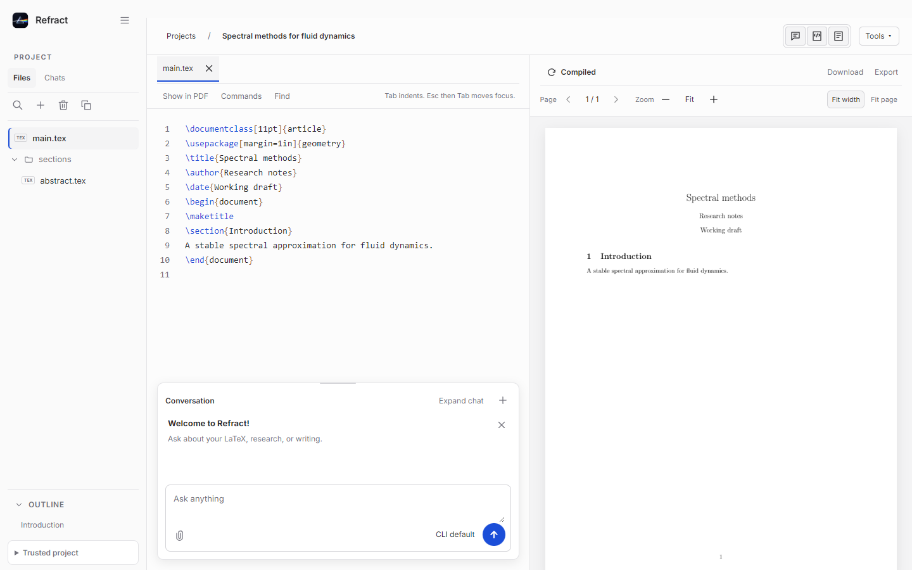
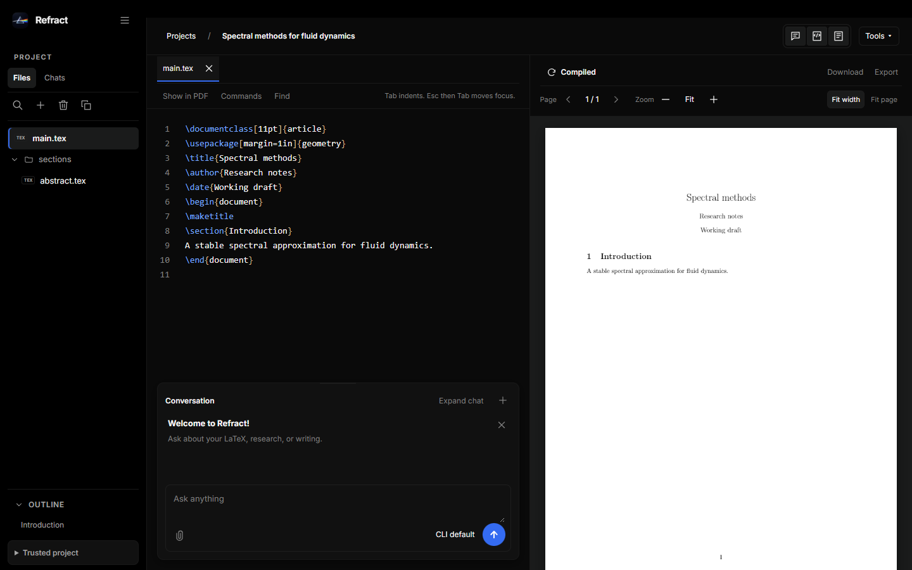
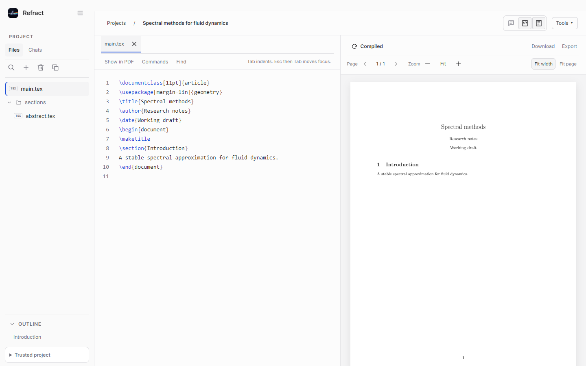
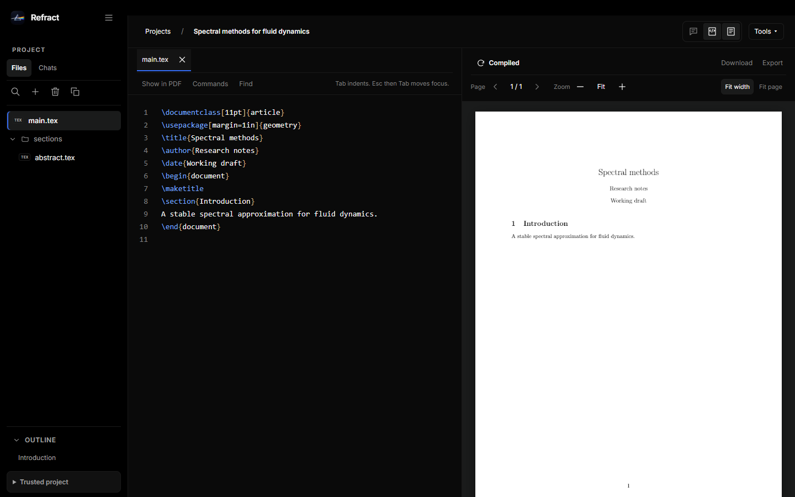
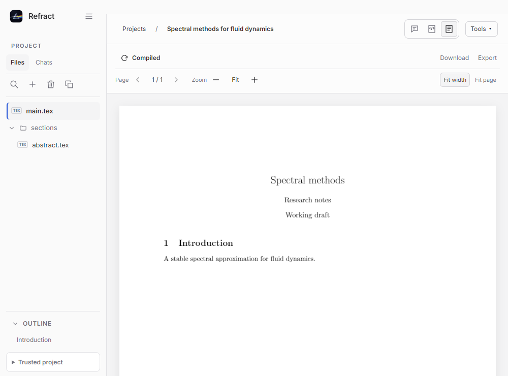
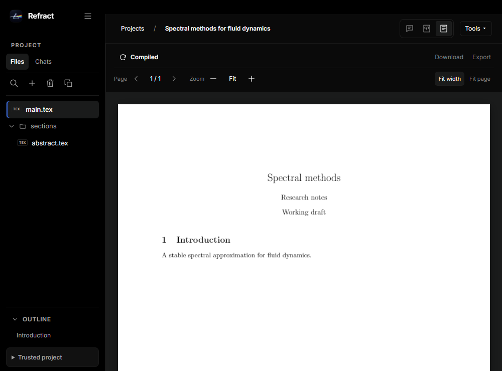

# Workspace pane toggles (RF-031)

The top bar now has Agent, Editor and Preview icon buttons. Each button has a tooltip, accessible name and pressed state. Any combination is available in wide windows. Hiding the final pane restores the editor, so the workspace never becomes empty.

Visibility is saved locally across restarts. At widths up to 1200px, Preview switches away from Editor/Agent; enabling Editor or Agent switches back. Simply resizing a wide split layout hides the preview temporarily and restores it when widened. Explicit toggles save the new selection.

Tools is temporary: its expansion updates the pane indicators without overwriting the saved layout. A pane toggle exits Tools. Expand chat and source/PDF navigation use the same pane state. Editor selection, contents and chat drafts survive hiding and restoring panes.

Screenshots use the real renderer, bundled fonts and PDF rendering with isolated sample IPC data in headless Chromium. No native windows are opened. Regenerate with `npm run build` and `node build/scripts/capture-pane-layout.cjs` after configuring `REFRACT_TEX_BIN`.

| Layout | Light | Dark |
| --- | --- | --- |
| All panes |  |  |
| Editor and preview |  |  |
| Narrow preview |  |  |

Verification: TypeScript build; nine headless UI checks; hidden Electron layout transitions in light/dark and wide/narrow windows passed. The broader desktop palette test was blocked by its existing untrusted sample-project fixture before layout assertions.
