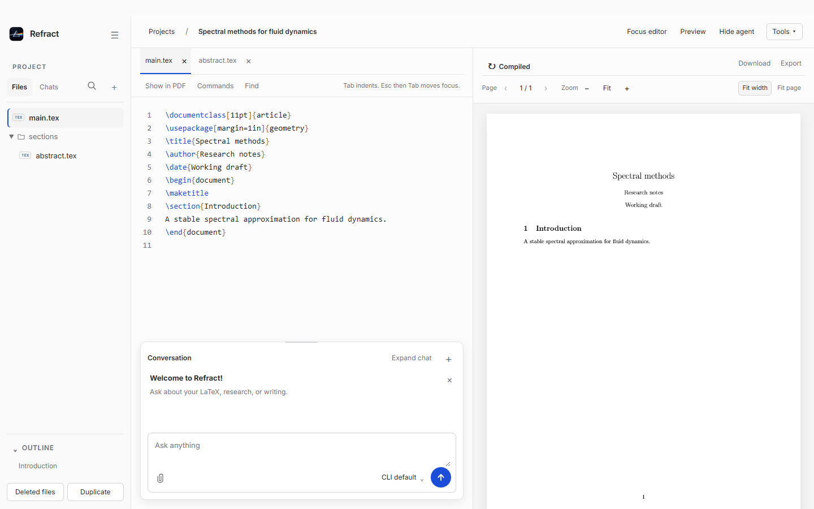
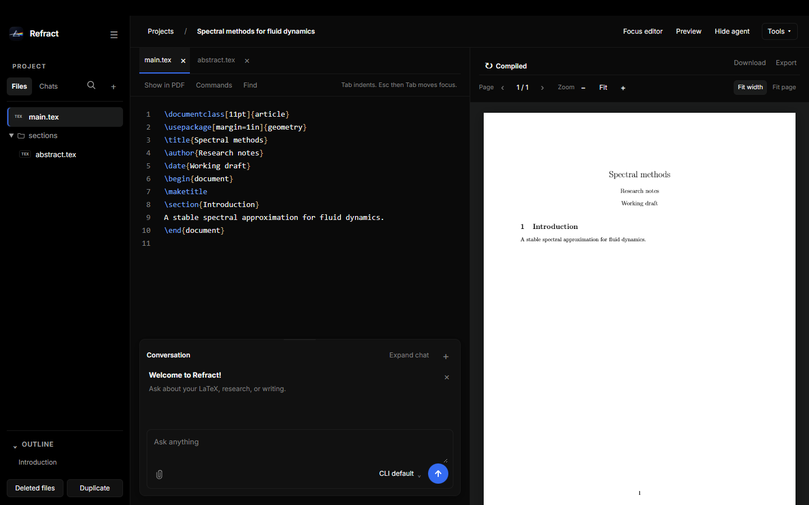

# UI palette

Refract follows the system light/dark preference. Its neutral surfaces and blue
actions use T3 Code's standard desktop palette from stable release
[v0.1.9](https://github.com/pingdotgg/t3code/blob/v0.1.9/packages/shared/src/themePalettes.ts),
specifically `T3_CODE_LIGHT_THEME_COLORS` and `T3_CODE_DARK_THEME_COLORS`.
This is the standard T3 Code palette, rather than the optional T3 Chat theme.

Typography follows the same stable source: the interface uses the
[default sans stack](https://github.com/pingdotgg/t3code/blob/v0.1.9/apps/web/src/appearanceFonts.ts),
including **Inter Variable** on Windows, and code uses its concrete monospace
stack (`SF Mono`, `SFMono-Regular`, Menlo, Consolas, Liberation Mono, monospace).
Inter is self-hosted from `@fontsource-variable/inter@5.3.0`, compatible with the stable web app's
`^5.3.0` dependency. Normal variable weights 100-900 and all seven character
subsets from that package's default stylesheet are bundled in `resources/fonts`.
The Inter SIL Open Font License is included there. The build copies these assets
into the app; no remote font service or system font installation is needed.

The semantic variables in `style.css` own the canvas, sidebar, surfaces, text,
borders, actions, selection, and focus colors. Native Windows titlebar controls
in `main.cts` match the sidebar. White PDF paper and semantic diagnostic and
syntax colors remain distinct from application chrome.

The project library separates search and sorting from creation actions. Inside a
project, the breadcrumb and workspace controls sit above both panes; file tabs
and editing commands remain with the source. The assistant has its own resizable
dock and full conversation view. Narrow windows switch explicitly between source
and preview. PDF fit modes stay in the zoom control group.

The stylesheet is organized by component, with shared semantic color tokens and
explicit responsive rules. Picker width belongs to CSS; TypeScript measures and
positions the overlay. Keyboard focus survives model-list updates, and resize
separators report pixel ranges and values. Native dialogs use their visible
headings as accessible names.

`test/ui-theme.test.cts` retains the original Electron integration checks.
`test/ui-polish-headless.test.cts` runs the actual renderer headlessly against
isolated sample IPC data, covering editor escape, indentation/completion,
context menus, dialog submission, IME handling, comment draft preservation,
selected states, and picker dismissal without creating native windows.

Run `npm run build` and `node build/scripts/capture-ui.cjs` to refresh all 26
images headlessly. The capture uses a fresh fixture per theme, waits for PDF
rendering, and checks matching dimensions, pane sizes, selections, and comments.
`docs/ui/capture-manifest.json` records those checks. Set
`REFRACT_THEME_ARTIFACTS` to capture into a different directory.

The final independent GPT-6.1 Sol review at high reasoning rated navigation,
editing, chat, model selection, PDF/tools, dialogs, theme consistency, compact
accessibility, stylesheet maintainability, and the overall layout overhaul 10/10, including typography fidelity.

[Browse all 13 UI views in both themes](ui-gallery.md).

